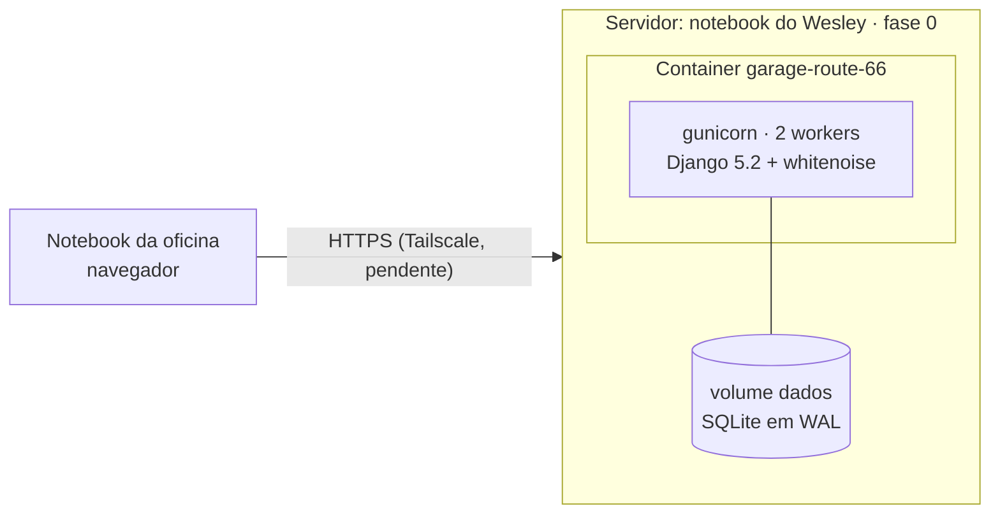

# Garage Route 66: ordens de serviço

Sistema de ordens de serviço (OS) da oficina **Garage Route 66** (Parelheiros, São Paulo/SP).
Substitui a OS em papel: cadastro de cliente e veículo, orçamento com peças e serviços, aprovação do cliente,
acompanhamento do serviço e entrega.

- **Usuária:** a recepcionista, num notebook da oficina, pelo navegador.
- **Estado:** V1 em desenvolvimento. Veja o [CHANGELOG](CHANGELOG.md) e o caminho até a produção em [docs/operacao.md](docs/operacao.md#estado-da-produção).

## Arquitetura



| Camada | Escolha | Motivo (detalhes no [ADR 0001](docs/decisoes/0001-caminho-stack-e-infra-da-v1.md)) |
|---|---|---|
| Linguagem/framework | Python 3.12 + Django 5.2 LTS | Suporte até 2028 |
| Arquitetura | Monolito modular: `oficina` (domínio) + `balcao` (interface) | 1 container, regras num lugar só ([ADR 0002](docs/decisoes/0002-monolito-modular-e-interface-htmx.md)) |
| Interface | Django templates + HTMX + Bootstrap, sem Node | Sem build de front; arquivos vendorizados |
| Banco | SQLite (arquivo único) | 1 usuária; backup é copiar um arquivo; zero operação |
| Servidor | gunicorn + whitenoise num container | Sem nginx: um processo a menos para operar |
| Dependências | uv (`pyproject.toml` + `uv.lock`) | Reprodutível, com hashes |
| Acesso | Tailscale (pendente) | Nada exposto na internet |

## Estrutura do repositório

```
config/              Configuração do Django (settings via variáveis de ambiente, rotas)
balcao/              Interface da recepcionista: quadro de OS, nova OS, detalhe (templates + HTMX + Bootstrap)
  static/balcao/vendor/  Bootstrap 5.3.3 e HTMX 2.0.4 vendorizados (hashes em SHA256SUMS)
oficina/             App de domínio (não depende de interface)
  models.py          Cliente, Veículo, Fornecedor, OS, Item, Aprovação, Histórico (regras de negócio)
  validators.py      CPF, CNPJ (inclusive alfanumérico), placa e telefone
  admin.py           Backoffice (Django admin): fornecedores e correções
  views.py           /saude/ (healthcheck)
  formatacao.py      Formatação em R$
  tests/             Testes unitários (rodam em ~1s, sem rede)
docs/
  dominio.md         Regras de negócio: o que o sistema garante e onde está no código
  operacao.md        Runbook: subir, atualizar, logs, problemas comuns, variáveis de ambiente
  negocio.md         Contexto da oficina e a OS em papel original
  decisoes/          ADRs (decisões de arquitetura)
  pareceres/         Análises que embasaram as decisões
  aprendizado.md     Conceitos aprendidos durante o projeto
.claude/agents/      Time de agentes do Claude Code (arquiteto, dev, qa, dba, infra, sre, segurança...)
Dockerfile           Imagem de produção (multi-stage)
compose.yaml         Execução em produção
```

## Desenvolvimento

Pré-requisito: [uv](https://docs.astral.sh/uv/). Ele instala o Python 3.12 sozinho.

```bash
cp .env.example .env                       # e preencha DJANGO_SECRET_KEY (comando de geração no arquivo)
uv sync                                    # cria o .venv a partir do uv.lock
uv run --env-file .env python manage.py migrate
uv run --env-file .env python manage.py createsuperuser
uv run --env-file .env python manage.py runserver   # http://127.0.0.1:8000/
```

**Testes**, obrigatórios para qualquer mudança:

```bash
uv run --env-file .env python manage.py test
```

**Mudou um model?** Rode `makemigrations`, revise o arquivo gerado em `oficina/migrations/` e commite junto com o código.

## Produção

```bash
docker compose up -d --build                                       # sobe ou atualiza
docker compose exec app python manage.py createsuperuser           # só no primeiro acesso
```

Configuração em `.env.prod` (fora do git). Operação completa, backup e solução de problemas estão em [docs/operacao.md](docs/operacao.md).

## Regras do projeto

- **Teste unitário para tudo** o que for implementado.
- **Toda mudança atualiza a documentação** no mesmo commit: este README, `docs/dominio.md`, `docs/operacao.md` e o `CHANGELOG.md`, conforme o caso.
- Decisões de arquitetura viram ADR em `docs/decisoes/`.
- Segredos e dados de clientes nunca entram no git.
