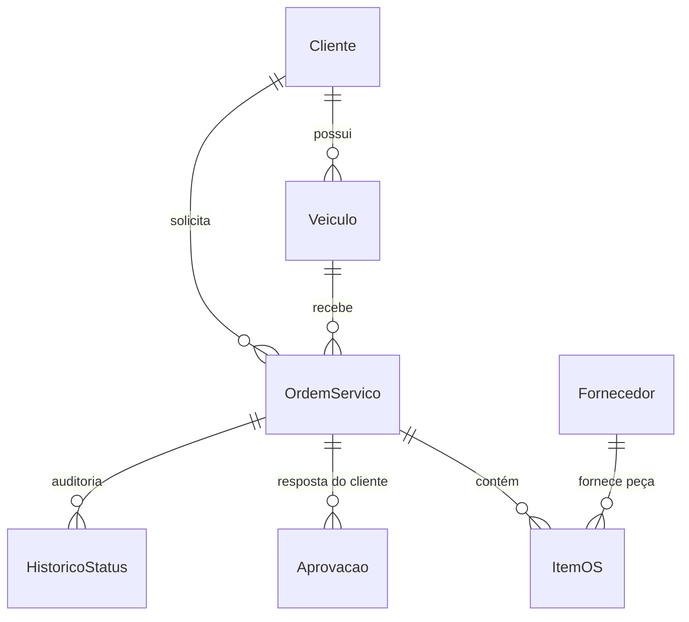
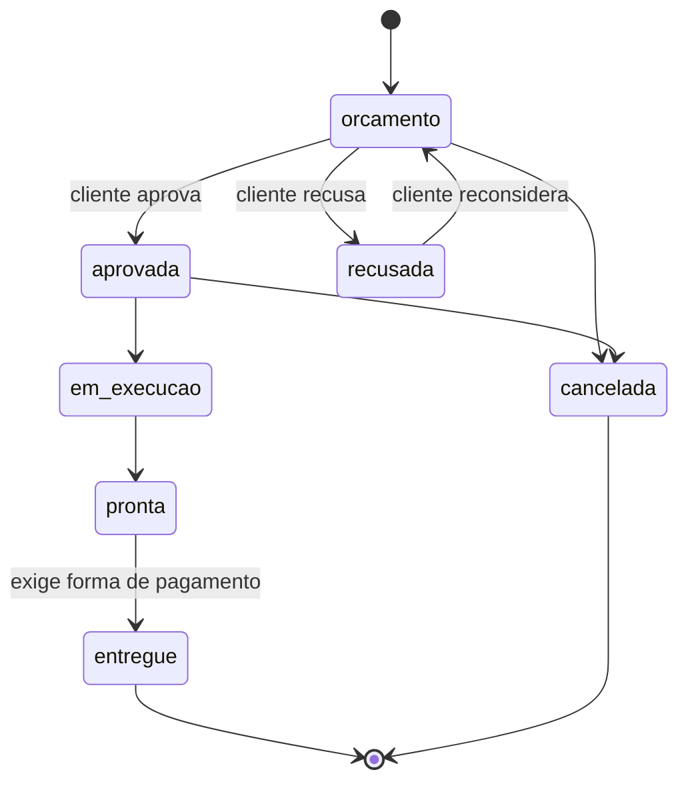

# Domínio: regras de negócio

O que o sistema garante e onde cada regra está implementada. Toda regra aqui tem teste em `oficina/tests/`.

## Entidades

| Entidade | Campos-chave | Observações |
|---|---|---|
| **Cliente** | nome, documento (CPF/CNPJ), telefone | Documento e telefone opcionais, guardados sem máscara. Documento único quando informado |
| **Veículo** | placa, marca, modelo, ano, cliente | Placa única, maiúscula, sem hífen (`FIB3F99`). Formatos antigo e Mercosul |
| **Fornecedor** | nome, telefone | Autopeças onde as peças são cotadas (ex.: "Primo") |
| **OrdemServico** | número, cliente, veículo, km, relato, diagnóstico, status, forma de pagamento | Número sequencial sem buracos |
| **ItemOS** | tipo (peça/serviço), descrição, quantidade, valor unitário, origem, fornecedor, situação | Total calculado, nunca digitado |
| **Aprovacao** | decisão, canal, quem respondeu, valor, data | Valor congelado no momento da resposta |
| **HistoricoStatus** | de, para, motivo, data | Toda mudança de status fica registrada |

## Ciclo de vida da OS

- As transições ficam em `OrdemServico.TRANSICOES` (`oficina/models.py`). Qualquer outra é recusada.
- **Aprovar ou recusar** usa `registrar_decisao()`: exige ao menos 1 item, registra canal (presencial, telefone ou WhatsApp) e quem respondeu, e guarda o valor total naquele momento.
- **Entregar** exige forma de pagamento (dinheiro, PIX, débito ou crédito) e grava `entregue_em`. Não existe venda fiado.
- No admin, o campo **"Próximo passo"** oferece só as transições válidas a partir do status atual.

## Itens e valores

- **Peça** sempre tem origem: `fornecedor` (com fornecedor opcional) ou `cliente` (trazida pelo cliente, **valor zerado**: não se cobra).
- **Serviço** não tem origem nem fornecedor.
- **Situação:** `ativo`, `devolvido` (ao fornecedor) ou `removido`. Só itens ativos entram no total.
- **Edição de itens:** permitida em orçamento, aprovada e em execução (cobre o orçamento complementar). Com a OS pronta,
  entregue, recusada ou cancelada, só a situação pode mudar (devolução de peça).
- **Dinheiro:** `Decimal(10,2)`; quantidade `Decimal(10,3)` (ex.: 3,5 L de óleo).
  `valor_total = quantidade × unitário`, com **arredondamento comercial** (`ROUND_HALF_UP`).
  Totais somados em Python, não em SQL, porque o SQLite somaria em ponto flutuante.

## Integridade: o que nunca acontece

| Garantia | Como | Onde |
|---|---|---|
| Número de OS repetido ou pulado | Tabela `Contador`, incrementada na mesma transação do INSERT | `Contador.proximo` |
| Apagar cliente, veículo, OS, item ou aprovação | `on_delete=PROTECT` + exclusão desabilitada no admin | `models.py`, `SemExclusao` em `admin.py` |
| OS com veículo de outro cliente | Validação em `OrdemServico.clean` | `models.py` |
| Quantidade ≤ 0, valor negativo, origem incoerente, peça do cliente cobrada | `CheckConstraint` **no banco** (vale até se o código for contornado) | `ItemOS.Meta.constraints` |
| CPF/CNPJ/placa/telefone inválidos | Validadores com dígito verificador | `validators.py` |

## Dados pessoais (LGPD)

Coletamos só o necessário para a OS: nome, documento (opcional), telefone e placa. Endereço e e-mail não são coletados.
Pendente (backlog): rotina de anonimização após o prazo de retenção, a definir com o agente `seguranca`.
